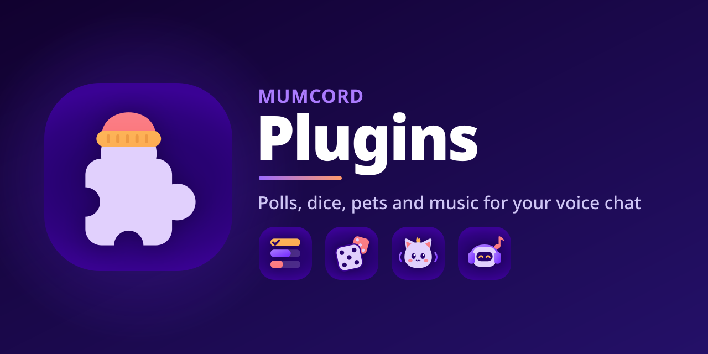

  

# Mumcord plugins

**Your Mumble server. Finally cosy.**

Registry source and official plugins for [Mumcord](https://github.com/Mumcord/mumcord), the modern client for any Mumble server. Plugins add small extras on top of voice chat (polls, dice rolls, virtual pets, a remote for your music bot) without touching the server: they run inside Mumcord and talk to the same plugin of other Mumcord users through standard Mumble plugin data messages. People on the official Mumble client see a plain text line where it matters and nothing else.

## Official plugins

| | Plugin | What it does |
|:-:|---|---|
|  | [**Poll**](poll/) | Ask the channel a question with up to ten options and watch the votes come in live. |
|  | [**Dice roller**](dice/) | `/roll d20` or `2d6+3` with fair rolls that others in the channel can witness and verify. |
|  | [**Echolings**](echolings/) | A little creature made of sound that grows while you hang out with friends. It never dies and never nags. |
|  | [**Mumbot Music**](mumbot-music/) | Control a mumbot music bot in your channel: now playing, skip, volume, queue and adding tracks. |

## How plugins work

- **Safe sandbox.** A plugin is a small WebAssembly program that runs in a strict sandbox inside Mumcord. It has no raw network or direct file access, and Mumcord draws its interface from built-in building blocks.
- **Permissions you can see.** Every plugin lists the permissions it needs before you install it. Optional permissions can be turned off at any time, and an update that asks for more waits for your approval.
- **Signed.** The registry index and every package are signed (minisign). Mumcord checks the size, hash, author signature and manifest before installing, and a kill switch (`revoked.toml`) can turn off a bad version everywhere.
- **No server changes.** Everything stays client side and works against an unmodified Mumble server.

## Install a plugin

1. Open **Settings > Plugins > Browse** in Mumcord.
2. Pick a plugin, review its permissions and choose **Install**.
3. Its icon appears in the plugins strip under the channel tree. Updates install automatically when they need no new permissions.

Nothing is preinstalled. **Turn off all plugins** in Settings > Plugins stops every plugin at once.

## Build your own

Plugin logic is written in Rust and compiled to WebAssembly.

- **Template:** [`template/`](template/) is the starting point that `mumcord-plugin new` copies.
- **CLI:** `mumcord-plugin` creates, builds (reproducibly), checks and tests a plugin, and can serve a local registry to try it in the client.
- **Docs:** [`docs/`](docs/) holds the user guides and the author documentation, published at
  [mumcord.github.io/plugins/docs](https://mumcord.github.io/plugins/docs/).

## Submitting a plugin

Propose your plugin with a pull request that adds its registry entry under `plugins/<id>/`. A new plugin, a new author key or a new permission needs **one maintainer approval and green CI**: schema validation, reproducible rebuild, author signature, permission-diff comment, mock-host load test and licence scan. Plugins must use an OSI-approved licence, build reproducibly and contain no ads, tracking, payments or loot boxes. See [`policy/REVIEW.md`](policy/REVIEW.md).

## Repository layout

- `plugins/<id>/plugin.toml`, `plugins/<id>/versions/<ver>.toml`, media: registry entries
- `poll/`, `dice/`, `echolings/`, `mumbot-music/`: official plugin sources (AGPL-3.0, own `LICENSE` each)
- `policy/REVIEW.md`: review policy
- `revoked.toml`: revoked plugin versions and keys
- `docs/`: user guides and author documentation (Apache-2.0); `mkdocs.yml` and `docs-site/` build the
  documentation site
- `schemas/`: registry file schemas
- `template/`: plugin template (Apache-2.0)
- `assets/brand/`: banner and icon; `render.sh` rebuilds every PNG from the SVG masters

## Licences

There is no repository-wide licence; each part carries its own `LICENSE`:

- Official plugins (`poll/`, `dice/`, `echolings/`, `mumbot-music/`): AGPL-3.0-or-later
- Template (`template/`) and docs (`docs/`): Apache-2.0
