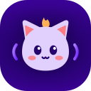

# Echolings

A little creature made of sound that grows while you hang out with friends. It never dies, never
gets sick, never leaves and never nags.

## Your Echoling

- **5 species:** Fizzle (energetic), Burrble (chatty), Mossmo (cosy), Zapling (competitive) and
  Hushmoth (shy).
- **3 colours** per species.
- **4 growth stages:** Hum → Sprout → Buddy → Echo.

Your pet lives in the plugins strip, shows as your badge next to your name (it bobs while you talk)
and appears on your profile card.

## How it grows

Your Echoling grows from the time you spend together with others, in voice and in chat. Idling
alone does not count.

- **Cheer** rises with company and falls slowly while you are away, but never very low: your pet
  just misses you.
- **Energy** falls while your pet is active and refills with naps and quiet time.
- **Bond** only ever goes up. It decides when your pet reaches the next stage.

In the panel you can **Pat**, give a **Treat**, **Play** or send it for a **Nap**.

## With friends

Friends in your channel who also run Echolings see your pet next to your name and on your profile
card, and you see theirs. Open someone's profile card to pat their pet.

## Calm by design

- When you turn on **Do Not Disturb**, your pet sleeps and stays quiet.
- Animations can be set to **Full**, **Subtle** or **Still**. Your system's reduced-motion setting
  always wins.

## Permissions

| Permission | Why |
|---|---|
| Panel (required) | Your pet and the care actions |
| Member badge (required) | Your pet next to your name |
| Profile card (required) | Your pet on your profile card |
| Who is talking (required) | Grow while you talk with others |
| Who is in your channel (required) | Know when you have company |
| Your own status (required) | Sleep while you are in Do Not Disturb |
| Messages to the same plugin (optional) | Show your pet to friends who also run Echolings |
| Chat cards (optional) | Echo Echo, the tune game you start with **Play** |
| Notifications (optional) | Tell you when a friend pats your pet |
| Chat activity (optional) | Grow when you chat. Never the text itself. |
| Sealed web view (optional) | Extra views inside Mumcord, with no internet access |

[Source code](https://github.com/Mumcord/plugins/tree/main/echolings)
