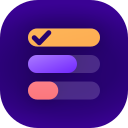
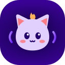

# Official plugins

The official plugins are free, open source (AGPL-3.0-or-later) and available in all 24 Mumcord
languages. Install them from **Settings → Plugins → Browse** ([how](../install.md)).

| | Plugin | What it does |
|:-:|---|---|
|  | [**Poll**](poll.md) | Ask the channel a question with up to ten options and watch the votes come in live. |
|  | [**Dice roller**](dice.md) | `/roll d20` or `2d6+3` with fair rolls that others can witness and verify. |
|  | [**Echolings**](echolings.md) | A little creature made of sound that grows while you hang out with friends. |
|  | [**Mumbot Music**](mumbot-music.md) | A remote for your mumbot music bot. |
| | [**EVE Fit**](eve-fit.md) Coming soon | Paste an EVE Online fitting in chat and everyone sees a ship card. |
